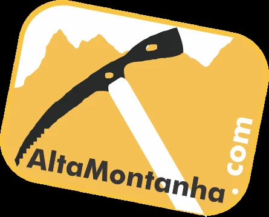
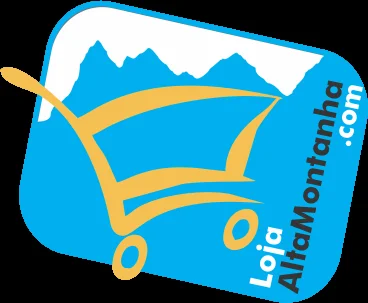
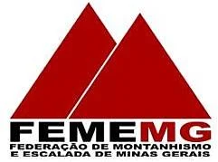

# Créditos

Este guia é de autoria de:

- **Daniel Ferreira Mariano**
- **Eustáquio Macedo Melo Júnior**

**Ano:** 2002

**Disponível em:** [www.rumos.net.br](http://www.rumos.net.br)

## Revitalização e Manutenções (2026+)

Inspeções técnicas e manutenções coordenadas e executadas por:

- **ACEC-MG** (Associação Cultural e Esportiva do Carste de Minas Gerais)
- **Rupestre da Lapa Aventuras**

**Grupo de Trabalho de Escalada da Lapinha (GTEL):** Helon Brazil, André Portugal, Renato Utsch, Warleson Campos, William Cruz, Denise Brazil, Gi Reis e Manassés.

Para o detalhamento técnico completo das vistorias, intervenções realizadas por via e controle de doações de proteções, consulte o [Relatório Consolidado de Inspeções e Manutenções da Gruta da Lapinha](https://docs.google.com/document/d/1MDqztuc2f4zKHfUeX_xBjNso7Izohre6s53erApKYZY/edit).

Em conformidade com a Portaria IEF nº 72/2023, protocolos operacionais do Parque Estadual do Sumidouro (PESU) e autorização dos conquistadores.

> Escale com segurança, respeite o local e traga seu lixo de volta para casa.
