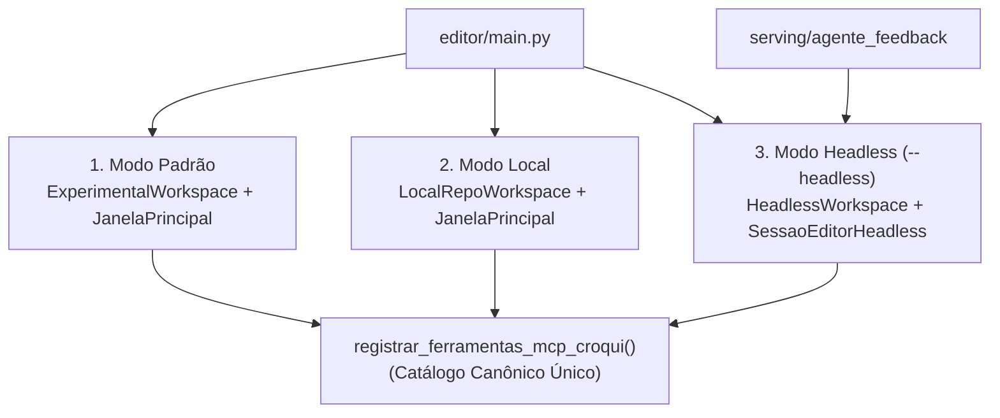
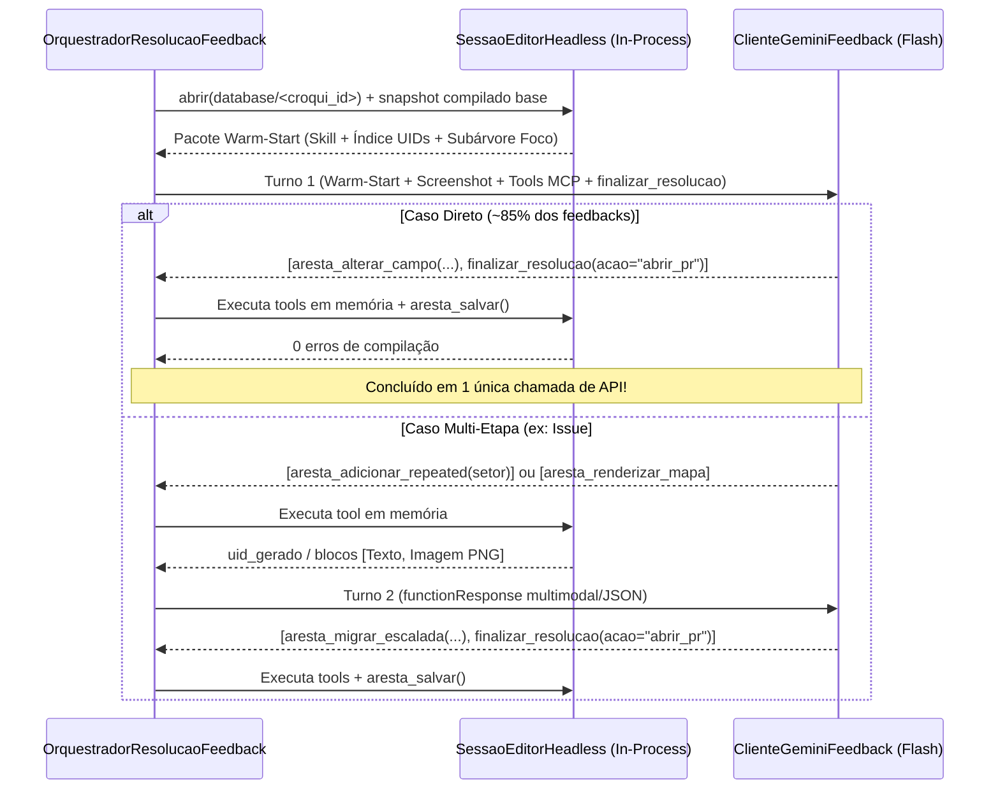

# Design

## Context

Veja `proposal.md` para a motivação completa. Hoje o Editor Aresta possui duas portas de entrada em `editor/main.py` e `editor/core/workspace.py` (`ExperimentalWorkspace` para usuários finais e `LocalRepoWorkspace` para edição local com GUI), enquanto o catálogo completo de ferramentas MCP é registrado dentro de `JanelaPrincipal._registrar_ferramentas_mcp` (`editor/legacy_views/area_principal.py`). Em paralelo, `serving/agente_feedback/` reimplementava manualmente leitura parcial de `.md`, régua estática em Pillow e substituição textual completa de arquivos em 1 chamada JSON ao Gemini Flash (AI Studio Free Tier, ~250–500 reqs/dia).

## Goals / Non-Goals

**Goals:**
- Estabelecer o **Modo Headless** como 3ª porta oficial e sustentada do Editor Aresta (`HeadlessWorkspace` + `SessaoEditorHeadless` + `editor/main.py --headless`), sem instanciar nenhum `QWidget` nem tocar em `generated/` ou `STATUS_CROQUIS.md`.
- Unificar o registro das ferramentas MCP em um único módulo compartilhado pelos 3 modos do Editor.
- Permitir que o agente de feedbacks resolva casos diretos em **1 único turno de IA** (*Parallel Function Calling* com *Warm-Start*) e casos multi-etapa (como a Issue #108 ou ajuste visual de POIs com `aresta_renderizar_mapa`) em até `max_turnos` turnos em processo (*zero IPC/HTTP overhead*).
- Proteger o repositório e a cota gratuita com deduplicação no GitHub Actions, desistência voluntária, *Circuit Breaker* de turnos e guarda determinística de **Mudança Maior** baseada em `serving/diff_croqui_pr_lib.py`.

**Non-Goals:**
- Expor `Undo/Redo` como ferramentas MCP (continua proibido para agentes).
- Alterar o contrato de aprovação e publicação final (`pr-db-validator.yml` e `pr-integrator.yml` permanecem responsáveis por gerar `resumo.html` na PR e compilar `generated/` no merge).
- Criar atalhos artificiais de apelidos temporários no `resolver_alvo_mcp` (casos de criar container novo + migrar item rodam naturalmente em 2 turnos usando o `UID` NanoID real retornado no Turno 1).

## Decisions

### 1. Arquitetura das 3 Portas de Entrada e `HeadlessWorkspace`

- **Escolha**: Criar `HeadlessWorkspace` em `editor/core/workspace.py` (implementando `EditorWorkspace`) onde `obter_caminho_database()` aponta para `database/<id>` e `obter_caminho_compilado()` aponta para um `TemporaryDirectory` gerenciado pelo ciclo de vida do workspace, executando `deploy(..., is_producao=False, sair_ao_falhar=False)` na compilação sem atualizar `STATUS_CROQUIS.md` nem gravar diário persistente no repositório. Criar `SessaoEditorHeadless` em `editor/mcp/sessao_headless.py` (garantindo `QT_QPA_PLATFORM=offscreen` e `QGuiApplication.instance() or QGuiApplication([])`, carregando migrações + `CroquiModel` + `GerenciadorHistorico` + `CroquiController` + `MapasController` + `ServidorMCP` sem rede HTTP por padrão, e expondo `stdio` quando acionado via `editor/main.py --headless`).
- **Alternativa descartada**: Instanciar `CroquiModel` de forma avulsa dentro de `serving/agente_feedback/`. Descartada porque acoplaria `serving/` a detalhes internos de carga/serialização do Editor e duplicaria o registro de ferramentas MCP.

### 2. Execução em Processo (*In-Process MCP*) + *Warm-Start* + Loop de 1 a $N$ Turnos

- **Escolha**:
  1. **Conversão automática de esquemas MCP -> Gemini Function Declarations**: As ferramentas do `ServidorMCP` (filtrando ferramentas irrelevantes para feedback de croqui existente, como `aresta_particionar_pdf_croqui`, `aresta_criar_novo_croqui`, `aresta_importar_croqui_oficial`, `aresta_abrir_croqui_existente`, `aresta_focar_elemento`, `aresta_capturar_canvas`, `aresta_obter_selecao_atual` e `aresta_coletar_betas`) são expostas diretamente no campo `tools` da API REST `generateContent` do Gemini (`gemini-3.8-flash`), acrescidas da ferramenta `finalizar_resolucao(acao, titulo_pr, resumo_mudanca, motivo)`.
  2. **Suporte Multimodal nas Respostas de Ferramenta**: Quando `aresta_renderizar_mapa` retorna blocos `[Texto, Imagem Base64]`, o cliente converte o texto em `functionResponse` e injeta as imagens correspondentes na mensagem de retorno ao modelo para que ele veja a grade métrica e as miras `(-50..+50px)` dos POIs.
  3. **Skill dedicada `.agents/skills/resolver_feedback_croqui/SKILL.md`**: Contém as diretrizes concisas de domínio (uso de `UID`s, preservação de `UID` via `aresta_migrar_escalada`, criação de setor quando citado pelo usuário, uso sob demanda de `aresta_renderizar_mapa` e critérios explícitos de desistência `nao_acionavel`), carregada no *Warm-Start* e também consultável por qualquer agente no Editor Desktop!
- **Alternativa descartada**: *Cold-Start* puro sem *Warm-Start* (gastaria 5–7 turnos por Issue apenas descobrindo `UID`s e schema, exaurindo rapidamente o Free Tier).

### 3. Guarda Determinística de Mudança Maior via `diff_croqui_pr_lib`

- **Escolha**: Antes de iniciar o loop do agente, compilamos o estado base de `database/<croqui_id>` em um diretório temporário `dir_base`. Quando `aresta_salvar()` conclui sem erros (já deixando o compilado atualizado no diretório temporário do `HeadlessWorkspace`), calculamos `calcular_diff_pull_request(dir_base, dir_headless_compilado)`. Se o evento **não** veio de `/ai-fix` de mantenedor, classificamos como **Mudança Maior** caso ocorra qualquer um dos critérios:
  - Exclusão líquida de qualquer entidade (`status == "removido"` em `croqui.entidades` — picos, grupos, setores, escaladas — ou remoção de mapas/botões);
  - `total_setores_adicionados > 1`;
  - `(total_escaladas_adicionadas + total_escaladas_modificadas) > 5`;
  - Alteração dos metadados raiz `id` ou `publicar_croqui`.
  Nesses casos, o orquestrador restaura o snapshot original de `database/<croqui_id>`, não abre PR e publica na Issue o resumo detalhado das alterações propostas pedindo confirmação com `/ai-fix`.
- **Alternativa descartada**: Pedir apenas no prompt para o LLM julgar o que é "mudança maior". Descartada porque regras determinísticas sobre o Protobuf compilado são 100% auditáveis, imunes a alucinação e gratuitas em tokens.

### 4. Herança de Dependências `editor_headless` e Deduplicação no GitHub Actions

- **Escolha**:
  - Em `pyproject.toml`, criar `editor_headless` incluindo `validador`, `pyside6-essentials`, `pymupdf`, `pillow-heif`, `requests`, `fastapi`, `uvicorn` e `httpx`; alterar `editor` para `{ include-group = "editor_headless" }` mantendo apenas os pacotes exclusivos do app desktop.
  - Em `.github/workflows/ai-feedback-solver.yml`, disparar em `issues: types: [labeled]` (já que toda Issue criada com `feedback:croqui` pela Edge Function ou rotulada manualmente emite `labeled` com `github.event.label.name == 'feedback:croqui'`, eliminando a corrida dupla com `opened`) e adicionar `concurrency: group: ai-feedback-${{ github.repository }}-${{ github.event.issue.number }}` (`cancel-in-progress: false`).

## Risks / Trade-offs

- **[Schemas JSON do MCP com tipos abertos `{}` rejeitados pela API estrita do Gemini]** → Algumas ferramentas MCP usam `{"valor": {}}` para aceitar tipos polimórficos (string, número, booleano, dict ou lista). A API REST `functionDeclarations` do Gemini exige `type` explícito ou schema flexível compatível; implementaremos um adaptador testado em `cliente_gemini_feedback.py` que converte schemas abertos de argumentos polimórficos (ou serializa/normaliza via `OBJECT`/`STRING`/campos tipados suportados pela API Gemini) garantindo 100% de compatibilidade.
- **[Arquivos `.md` criados ou removidos pelo Editor Headless no Git]** → Ao criar um setor novo (Issue #108) ou remover um arquivo órfão, o conjunto de arquivos em `database/<croqui_id>/` muda. O snapshot/restauração em memória e o `executor_git` passarão a rastrear o diretório inteiro de `database/<croqui_id>/` (incluindo remoção de novos arquivos não rastreados no rollback e `git add -A -- database/<croqui_id>` no commit após validação estrita do Hard Jail).

## Migration Plan

1. Corte limpo (Princípio VIII do `AGENTS.md`): remover `serving/agente_feedback/renderizador_regua_mapa.py` e seu teste, substituindo os contratos de `ClienteGeminiFeedback`, `ClienteGeminiFeedbackFake` e `OrquestradorResolucaoFeedback` na mesma alteração.
2. Atualizar `pyproject.toml` e regenerar `uv.lock` com `uv lock`.
3. Validar 100% de cobertura nos módulos novos/alterados, `mypy`, `ruff` e campanha de regressão/fuzzing do Robô Caótico antes do lançamento.
