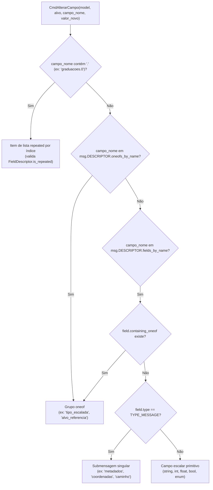

# Design: Simplificação da Camada de Comandos de Histórico

## Context

A pilha de desfazer/refazer (`GerenciadorHistorico`) e o diário transacional em disco (`GerenciadorDiario`, que grava `diario_pendente.bin` e `diario_salvo.bin`) são a espinha dorsal do Editor Aresta (Princípio VIII do `AGENTS.md`). Historicamente, conforme novas necessidades surgiram no editor (suporte a `oneof`, listas `repeated`, metadados de `CaminhoNovo`, imagens em memória, botões Markdown, migração de setores, mapas), foram criadas 16 classes de comandos distintas distribuídas entre `editor/commands/comandos_protobuf.py` e `editor/commands/comandos_mapas.py`.

Recentemente, o modelo de domínio passou por duas evoluções estruturais importantes:
1. **Identificadores Únicos (`UID`s) e `IndiceUidsModel`**: Entidades principais (`Setor`, `Escalada`, `Secao`, `Enfiada`, `Passagem`, `Parede`, `Face`) possuem campo `uid` indexado em $O(1)$ pelo `IndiceUidsModel`.
2. **Referências por `alvo_uid`**: As referências em `Mapa.Referencia` deixaram de referenciar escaladas pelo nome textual e passaram a usar `alvo_uid`. Com isso, `CmdRenomearEscalada` perdeu sua razão de existir (seu `undo()` e `executar_redo()` hoje apenas chamam `self.model._set_primitivo(msg, self.campo_nome, self.nome_novo)`).

Além disso, a introdução do servidor MCP (`editor/mcp/ferramentas_comandos.py`) evidenciou o custo de manter múltiplos comandos sobrepostos para alterar campos (`CmdAlterarPrimitivo`, `CmdAlterarOneof`, `CmdAlterarRepeatedItem`, `CmdAlterarMetadadosCaminhoNovo`) e comandos monolíticos que misturam mutação Protobuf com buffers de memória RAM (`CmdAlterarCampoImagem`, `CmdInserirImagemMarkdown`, `CmdInserirBotaoMarkdown`, `CmdAdicionarMapaArquivo`).

## Goals / Non-Goals

**Goals:**
- Reduzir os 16 comandos atuais para um núcleo canônico de **7 comandos** em `editor/commands/comandos_protobuf.py`:
  1. `CmdAlterarCampo` (unificado via Reflection do `DESCRIPTOR` Protobuf)
  2. `CmdAdicionarRepeated`
  3. `CmdRemoverRepeated`
  4. `CmdMoverRepeated`
  5. `CmdAlterarImagem`
  6. `CmdAlterarAnexo`
  7. `CmdMacro`
- Adotar endereçamento híbrido ancorado em `UID` em 3 níveis (`UID` direto -> `<uid_ancestral>.<subcaminho>` -> fallback posicional desde a raiz) sem alterar o `croqui.proto`.
- Expressar todas as operações compostas de alto nível nos Controllers e no servidor MCP (`migrar_setor`, `alterar_campo_imagem`, `inserir_imagem_markdown`, `inserir_botao_markdown`, `adicionar_mapa_com_arquivo`, `alterar_multiplos_repeated_items` e limpeza de imagens órfãs) como instâncias de `CmdMacro` compostas pelos 6 comandos folha canônicos.
- Isolar as 12 classes de comandos substituídas em `editor/commands/comandos_legados.py` exclusivamente para deserialização de diários existentes (`diario_pendente.bin` e `diario_salvo.bin`), garantindo 100% de retrocompatibilidade.
- Proteger o isolamento de `comandos_legados.py` com um teste de arquitetura estático via AST em `editor/arquitetura_mvc_test.py`.

**Non-Goals:**
- Não alterar o schema `aresta_api/proto/croqui.proto` (não adicionar `uid` a `Pico`, `Mapa` ou `Referencia` nesta mudança).
- Não quebrar nem converter forçadamente arquivos `diario_pendente.bin` ou `diario_salvo.bin` já gravados em croquis em andamento.
- Não remover as ferramentas de alto nível do servidor MCP (`aresta_migrar_setor`, `aresta_adicionar_mapa_arquivo`, `aresta_inserir_imagem_markdown`, `aresta_inserir_botao_markdown`, `aresta_vincular_referencia_mapa`), pois elas tornam a interação de agentes mais eficiente e menos propensa a erros.

## Decisions

### 1. `CmdAlterarCampo` Guiado por Introspecção do `DESCRIPTOR` (Reflection)

Em vez de exigir que o chamador escolha entre `CmdAlterarPrimitivo`, `CmdAlterarRenomearEscalada`, `CmdAlterarOneof`, `CmdAlterarRepeatedItem` ou `CmdAlterarMetadadosCaminhoNovo`, `CmdAlterarCampo` recebe `(model, alvo, campo_nome, valor_novo, valor_antigo=..., session_id=None)` e inspeciona o `DESCRIPTOR` da mensagem alvo:

- **Captura automática de `valor_antigo`**: Quando `valor_antigo` não é passado (ou é omitido via sentinela `_NAO_INFORMADO`), `CmdAlterarCampo` resolve a mensagem viva na instanciação e captura automaticamente o estado atual:
  - Para escalar primitivo: `getattr(msg, campo_nome)`
  - Para item indexado `"<campo>.<idx>"`: cópia do elemento `getattr(msg, campo)[idx]` (ou bytes serializados se for `TYPE_MESSAGE`)
  - Para `oneof`: tupla/dicionário representando a variante ativa (`WhichOneof(grupo)`) e o valor/bytes da variante ativa anterior (ou `None` se inativo)
  - Para submensagem singular (`TYPE_MESSAGE`): `getattr(msg, campo_nome).SerializeToString()` se `HasField(campo_nome)`, ou `None` se inativo (`ClearField` no `undo`)
- **Suporte a `mergeWith` por `session_id`**: Mantém o `id() == 1001` para campos escalares e faz merge quando `alvo`, `campo_nome` e `session_id` (não nulo) coincidem, preservando o `valor_antigo` original da sessão de digitação.
- **Serialização em JSON (`serializar` / `deserializar`)**: Persiste `alvo` (`caminho_msg`), `campo_nome`, a modalidade inferida (ou re-infere no `undo`/`redo`) e representa submensagens em base64 para compatibilidade com JSON no diário binário.

### 2. Resolução Híbrida de `alvo` em 3 Níveis (UID + Ancestral + Fallback Posicional)

Todo comando Protobuf canônico (`CmdAlterarCampo`, `CmdAdicionarRepeated`, `CmdRemoverRepeated`, `CmdMoverRepeated`) aceita como `alvo` tanto uma instância viva de `Message` quanto uma `str` de endereçamento:

1. **Nível 1 — `UID` direto (`"esc_1234"`)**:
   - Se a mensagem possui o atributo `uid` preenchido e registrado no `IndiceUidsModel`, seu identificador canônico é o próprio `uid`.
   - Caso especial de variante de `Escalada`: como `Boulder`, `Via`, `EnfiadaUnica`, `Artificial` e `Psicobloc` são variantes do `oneof tipo_escalada` dentro de `Escalada` (que tem `uid`), seu endereço é `"<uid_escalada>.<nome_variante>"` (ou resolvido diretamente via `IndiceUidsModel`).
2. **Nível 2 — Ancestral mais próximo com `UID` + subcaminho relativo (`"<uid_ancestral>.<subcaminho>"`)**:
   - Quando o objeto alvo não possui `uid` próprio (ex.: `Imagem` dentro de um `Setor`, `CaminhoNovo` dentro de `Via`, `Metadados` dentro de `CaminhoNovo`), o resolvedor identifica o ancestral mais próximo que possui `uid` e constrói o caminho relativo a partir dele (ex.: `"setor_abc.imagens.0"`).
3. **Nível 3 — Fallback posicional global desde a raiz (`"picos.0.imagens.1"`, `"mapas.0.referencias.2"`, `""`)**:
   - Para objetos que não possuem `uid` nem ancestral com `uid` (`Croqui` raiz `""`, `Pico`, `Mapa`, `Mapa.Referencia`), mantém-se o caminho posicional a partir da raiz `Croqui`.

Na resolução tardia (`_obter_msg()`), se o primeiro segmento do caminho (antes do primeiro `.`) existir no `IndiceUidsModel`, a navegação parte do objeto retornado em $O(1)$ pelo índice e percorre apenas o sufixo relativo; caso contrário, parte de `self.model.croqui`.

### 3. Comandos de Coleções `repeated`: 3 Classes Dedicadas com Assinatura Única

Em vez de fundir operações de lista em um único comando polimórfico com parâmetros mutuamente exclusivos, mantemos 3 classes canônicas com responsabilidade e assinatura únicas:
- `CmdAdicionarRepeated(model, alvo, campo_nome, item_msg=None, indice=-1)`
- `CmdRemoverRepeated(model, alvo, campo_nome, indice)`
- `CmdMoverRepeated(model, alvo, campo_nome, indice_origem, indice_destino)`

### 4. Separação Simétrica de Buffers em Memória: `CmdAlterarImagem` e `CmdAlterarAnexo`

O `CroquiModel` mantém dois dicionários independentes em RAM: `_imagens_em_memoria: dict[str, bytes]` (que emite `imagem_alterada` e sofre compressão WebP `VP8L` -> 90% ao salvar) e `_anexos_em_memoria: dict[str, bytes]`.
- **`CmdAlterarImagem(model, nome_arquivo, bytes_novos, bytes_antigos=...)`**:
  - Unifica adição (`bytes_antigos=None`), substituição e remoção (`bytes_novos=None`) de imagens `.webp` na memória RAM.
  - Emite `model.imagem_alterada.emit(nome_arquivo)` tanto no `executar_redo()` quanto no `undo()`.
  - Na serialização com `anonimizar=True` (telemetria), aplica `_anonimizar_bytes_webp` tanto em `bytes_antigos` quanto em `bytes_novos`.
- **`CmdAlterarAnexo(model, nome_arquivo, bytes_novos, bytes_antigos=...)`**:
  - Unifica adição (`bytes_antigos=None`), substituição e remoção (`bytes_novos=None`) de documentos anexos em `_anexos_em_memoria`.

### 5. Operações Compostas de Alto Nível via `CmdMacro`

Todas as operações que coordenam múltiplas mutações passam a ser fábricas/métodos nos Controllers que constroem e empilham um `CmdMacro`:
- **`alterar_campo_imagem` (`CroquiController`)**:
  - Constrói `CmdMacro` contendo:
    1. `CmdAlterarImagem(model, novo_nome, bytes_webp)` (se houver nova imagem)
    2. `CmdAlterarCampo(model, msg, campo_nome, novo_nome)`
    3. `CmdAlterarImagem(model, nome_antigo, None)` (se `nome_antigo` ficar órfão no croqui após a troca)
- **`inserir_imagem_markdown` e `inserir_botao_markdown` (`CroquiController`)**:
  - Constroem `CmdMacro` com `[CmdAlterarImagem / CmdAlterarAnexo, CmdAlterarCampo(model, msg, campo_md, texto_novo, texto_antigo)]`.
- **`adicionar_mapa_com_arquivo` (`MapasController`)**:
  - Constrói `CmdMacro` com `[CmdAlterarImagem(model, nome_arq, bytes_webp), CmdAdicionarRepeated(model, model.croqui, "mapas", novo_mapa)]`.
- **`remover_item_repeated` (`CroquiController` / `MapasController`)**:
  - Inspeciona imagens referenciadas pela subárvore que ficariam órfãs; se houver, empilha `CmdMacro` com `[CmdRemoverRepeated(...), CmdAlterarImagem(model, img_orfa, None), ...]`; caso contrário, empilha `CmdRemoverRepeated` diretamente.
- **`migrar_setor` (`CroquiController`)**:
  - Utiliza o planejador puro `planejar_migracao_setor` (`editor/core/migracao_setor.py`) e constrói um `CmdMacro` contendo:
    1. `CmdAlterarCampo` para cada referência de mapa impactada (ex.: limpeza de `alvo_uid` em mapas que deixam de cobrir o pico de destino)
    2. `CmdAlterarCampo` para cada escalada cujo `tipo_escalada` precise ser convertido por restrição de `eh_boulder` no destino
    3. `CmdRemoverRepeated` removendo o setor da lista de origem (`setores` ou `subsetores`)
    4. `CmdAdicionarRepeated` inserindo o setor clonado (com `uid` preservado) no pico de destino
  - Isso permite remover o mutador monolítico `CroquiModel._migrar_setor` de usos ativos (mantendo suporte apenas para `CmdMigrarSetor` em `comandos_legados.py` ou delegando internamente).

### 6. Isolamento de `comandos_legados.py` e Guarda AST

- Todas as 12 classes antigas são movidas para `editor/commands/comandos_legados.py`.
- `deserializar_comando` em `editor/commands/comandos_protobuf.py` importa `comandos_legados` localmente para manter o mapeamento completo de todas as tags `tipo` históricas (`CmdAlterarPrimitivo`, `CmdRenomearEscalada`, `CmdAlterarOneof`, `CmdAlterarRepeatedItem`, `CmdAlterarMultiplosRepeatedItems`, `CmdAlterarMetadadosCaminhoNovo`, `CmdAlterarCampoImagem`, `CmdInserirImagemMarkdown`, `CmdInserirBotaoMarkdown`, `CmdAdicionarMapaArquivo`, `CmdSubstituirImagemMemoria`, `CmdMigrarSetor`).
- Em `editor/arquitetura_mvc_test.py`, um novo teste percorre a AST de todos os arquivos `.py` do repositório sob `editor/` e garante que:
  1. Nenhum arquivo fora de `editor/commands/comandos_protobuf.py` (especificamente dentro da função `deserializar_comando`) e `editor/commands/comandos_legados_test.py` importe `comandos_legados`.
  2. Nenhum arquivo fora de `editor/commands/comandos_legados.py`, `editor/commands/comandos_legados_test.py` e da função `deserializar_comando` referencie os nomes das 12 classes legadas.

## Risks / Trade-offs

- **[Risco] Restauração de `UID` ao desfazer `CmdAdicionarRepeated` e refazer `CmdMacro`** -> **Mitigação**: `CmdAdicionarRepeated` já captura `self._item_adicionado.CopyFrom(nova_msg)` após a primeira execução (preservando os `UID`s gerados pelo `CroquiModel._adicionar_item_repeated`) e os restaura no `executar_redo()` subsequente. Em `CmdMacro`, quando um comando filho depende do item recém-adicionado ou quando `adicionar_mapa_com_arquivo` pré-popula `novo_mapa`, o `item_msg` já é passado pronto para `CmdAdicionarRepeated`.
- **[Risco] Ordem de execução no `undo()` de `CmdMacro` com limpeza de imagens órfãs** -> **Mitigação**: No `executar_redo()` da remoção com imagens órfãs, `CmdRemoverRepeated` executa antes de `CmdAlterarImagem(nome, None)`, ou vice-versa; no `undo()`, `CmdMacro` reverte na ordem inversa, garantindo que `CmdAlterarImagem` restaure os bytes da imagem na memória RAM antes que a View tente re-renderizar o item reinserido por `CmdRemoverRepeated.undo()` (basta colocar `CmdRemoverRepeated` como primeiro passo e `CmdAlterarImagem(..., None)` como segundo passo no `CmdMacro`: no `undo()`, `CmdAlterarImagem.undo()` roda primeiro restaurando os bytes em RAM, e `CmdRemoverRepeated.undo()` roda em seguida emitindo o sinal de reinserção para a View!).
- **[Risco] Deserialização de diários legados contendo `CmdMacro` com subcomandos antigos** -> **Mitigação**: `CmdMacro.deserializar` delega cada subcomando para `deserializar_comando(dados_filho, model)`, que resolve transparentemente tanto classes canônicas novas quanto as 12 classes de `comandos_legados.py`.

## Migration Plan

1. **Fase 1 — Comandos Canônicos e Isolamento Legado**:
   - Extrair as 12 classes legadas para `editor/commands/comandos_legados.py` e seus testes comportamentais para `editor/commands/comandos_legados_test.py`.
   - Implementar `CmdAlterarCampo`, `CmdAlterarImagem`, `CmdAlterarAnexo` e o endereçamento em 3 níveis (`UID` -> `<uid>.<subcaminho>` -> fallback posicional) em `editor/commands/comandos_protobuf.py`, com 100% de cobertura em `editor/commands/comandos_protobuf_test.py`.
2. **Fase 2 — Refatoração dos Controllers (`CroquiController` e `MapasController`)**:
   - Atualizar todos os métodos de `CroquiController` e `MapasController` para instanciar exclusivamente os 7 comandos canônicos e compor operações de alto nível via `CmdMacro`.
   - Remover `editor/commands/comandos_mapas.py` (e `comandos_mapas_test.py`), cujas responsabilidades foram absorvidas por `CmdAlterarImagem` + `CmdMacro` e `comandos_legados.py`.
3. **Fase 3 — Atualização do Servidor MCP (`ferramentas_comandos.py` e `resolvedor_alvo.py`)**:
   - Atualizar as ferramentas MCP para utilizar `CmdAlterarCampo`, `CmdAlterarImagem`, `CmdAlterarAnexo` e `CmdMacro`, mantendo as ferramentas de alto nível.
4. **Fase 4 — Limpeza de Código Morto e Guarda de Arquitetura AST**:
   - Limpar código morto em `editor/core/historico.py` (`CmdRemoverArquivoFisico` e ramificações de sinais não assinados).
   - Adicionar a verificação AST de isolamento de `comandos_legados.py` em `editor/arquitetura_mvc_test.py` e validar 100% de cobertura em toda a suíte.
