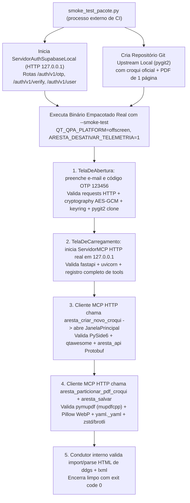

# Design

## Context

Conforme detalhado em `proposal.md`, o empacotamento PyInstaller do Editor Aresta em Windows e macOS possuía uma divergência silenciosa em relação ao grupo `editor` do `pyproject.toml` e ao empacotamento Flatpak do Linux: `obter_modulos_excluidos()` em `editor/build.py` removia `pymupdf` (`fitz`) e `lxml` (dependência de runtime do `ddgs`), impedindo a abertura da `TelaDeCarregamento` após a `TelaDeAbertura` e deixando um processo invisível travado em background.

Além da correção imediata do bundle, precisamos eliminar estruturalmente todas as brechas que permitiram que um binário incapaz de abrir chegasse à Microsoft Store e ao Cloudflare R2.

## Goals / Non-Goals

**Goals:**
- Garantir paridade integral de dependências de runtime entre Windows (MSIX), macOS (`.app`/`.dmg` ARM64 e Intel) e Linux (Flatpak), mantendo o pacote enxuto via remoção exclusiva de cabeçalhos de build-time (`mupdf-devel`).
- Tornar o registro do `ServidorMCP` e de todas as suas ferramentas parte invariante do ciclo de vida do Editor, sem opção de bypass.
- Eliminar processos zumbis sem janela quando falhas fatais ocorrem em transições de interface.
- Estabelecer 3 barreiras automatizadas complementares (teste rápido de contrato em PR, Robô Caótico com MCP registrado e smoke test pós-build executando os binários reais sem rede externa nas 4 variantes de distribuição).

**Non-Goals:**
- Autenticar contra o servidor Supabase de produção ou clonar repositórios da internet durante o smoke test de CI (proibido para evitar *rate limits* de OTP e falhas transitórias de rede).
- Alterar a ordem do corte de versão (`prepare_release` permanece realizando o commit/tag antes dos jobs por sistema operacional).

## Decisions

### 1. Reconciliação Automática entre `uv.lock` (`editor`), Imports de Produção e `obter_modulos_excluidos()`
- **Decisão**:
  1. Remover `"pymupdf"`, `"fitz"`, `"lxml"` e `"sqlite3"` de `obter_modulos_excluidos()` em `editor/build.py`, incluir `'pymupdf'` e `'ddgs'` em `pacotes_para_coletar` em `editor/EditorAresta.spec` e remover o `hiddenimport` inexistente `'scripts.finalizar_mapas'`.
  2. Adicionar filtro em `filtrar_datas_desnecessarios()` (e em `cleanup:` do `com.arestaclimb.Editor.yaml`) descartando `mupdf-devel` (~10 MB de cabeçalhos C/C++ inúteis em runtime).
  3. Substituir os testes *change-detector* e mocks de `editor/build_test.py` por testes reais que: (a) exportam `uv export --frozen --only-group editor` e verificam interseção vazia com `obter_modulos_excluidos()`; (b) importam todos os módulos de produção de `editor/`, `coleta_de_betas/` e `migracoes/` sob um import hook bloqueando `obter_modulos_excluidos()`; (c) validam que todos os `hiddenimports` do `EditorAresta.spec` são importáveis; (d) testam geração real de ícones `.ico`/`.icns` em `tmp_path` com `PIL.Image` real.
- **Alternativa descartada**: Tornar o import de `repartir_pdf` tardio dentro de `aresta_particionar_pdf_croqui` sem corrigir/testar o bundle. Isso violaria o Princípio VIII (Fail-Fast) e apenas adiaria o crash para o uso da ferramenta.

### 2. Abolição de `iniciar_mcp` em favor de `iniciar_rede_mcp`
- **Decisão**: Remover o parâmetro `iniciar_mcp` de `ControladorAplicativo`, `JanelaPrincipal` e `MotorRoboCaoticoQt`, substituindo-o por `iniciar_rede_mcp: bool = True`. Assim, `TelaDeCarregamento.garantir_servidor_mcp(iniciar_rede=self._iniciar_rede_mcp)` e `JanelaPrincipal.iniciar_servidor_mcp(..., iniciar_rede=self._iniciar_rede_mcp)` **sempre** executam e importam todos os módulos de ferramentas MCP, enquanto testes unitários e o Robô Caótico apenas passam `iniciar_rede_mcp=False` para evitar alocação de portas TCP desnecessárias.
- **Rationale**: O MCP é parte central da arquitetura do Editor; pular seu registro em testes criou um ponto cego artificial.

### 3. Proteção Fail-Fast contra Processos Zumbis nas Transições de Janelas
- **Decisão**: Em `ControladorAplicativo.executar_selecao()` e `mostrar_janela_principal()`, envolver a transição (onde `setQuitOnLastWindowClosed(False)` está ativo e a `TelaDeAbertura` já foi fechada) em captura estruturada que: (1) reporta a exceção ao Sentry via `capturar_excecao` / telemetria; (2) no modo `--smoke-test`, escreve o traceback em `stderr` e encerra imediatamente com `os._exit(1)` / `sys.exit(1)`; (3) em uso normal, aciona `mostrar_erro(...)` exibindo diálogo crítico e encerrando `ServidorMCP`, servidor de instância única e `QApplication`.

### 4. Arquitetura do Smoke Test Pós-Build Offline (`--smoke-test` + `smoke_test_pacote.py`)

- **Execução por plataforma antes da publicação**:
  - **Windows** (`build_editor_windows.yml`): Roda após o build PyInstaller do Canal Beta (antes do pacote/publicação R2) e após o build PyInstaller de Produção (antes do pacote/publicação Microsoft Store).
  - **macOS** (`build_editor_macos.yml`): No passo de empacotamento, monta primeiro o `EditorAresta.app`, verifica com `lipo -archs` que o executável corresponde a `arm64` ou `x86_64`, executa o smoke test contra `EditorAresta.app/Contents/MacOS/EditorAresta` (direto em `arm64` e via `arch -x86_64` sob Rosetta 2 em `x86_64`), e só então assina, gera o `.dmg` e notariza/publica.
  - **Linux** (`build_editor_linux.yml`): Após o `flatpak-builder`, executa o smoke test dentro do sandbox Flatpak (`flatpak run` / `flatpak build` com `QT_QPA_PLATFORM=offscreen` e `--share=network` local loopback) antes de publicar no Cloudflare R2.

## Risks / Trade-offs

- **[Cofre de senhas do SO bloqueado em runners CI headless]** → `GerenciadorSessao` já degrada de forma prevista em `inicializar_cofre()` mantendo a sessão criptografada/em memória sem falhar o login quando o Keychain/SecretService não está destrancado em ambiente CI, ao mesmo tempo em que exercita o carregamento real dos módulos `keyring` e `cryptography`.
- **[Aumento do tamanho do pacote Windows/macOS com `pymupdf`]** → Mitigado pela exclusão de `mupdf-devel` (~10 MB economizados) e manutenção da poda de submódulos não usados do Qt6 (`QtQuick`, `QtQml`, `QtWebEngine`, `Qt3D`, `opengl32sw`).

## Migration Plan

1. Implementar e validar localmente todas as correções, suíte unitária/integração e execução real de `smoke_test_pacote.py` contra um build local ou ambiente real.
2. Sincronizar delta specs e arquivar a mudança OpenSpec.
3. Fazer commit e push na `main` (referenciando `Fixes #100`) e disparar o workflow `release-editor.yml` (`bump_type=patch`, `publicar_microsoft_store=true`) para lançar a versão `0.6.3` em Windows (Beta + Store), macOS (ARM64 + Intel) e Linux (Flatpak), monitorando todos os jobs até a conclusão verde.
