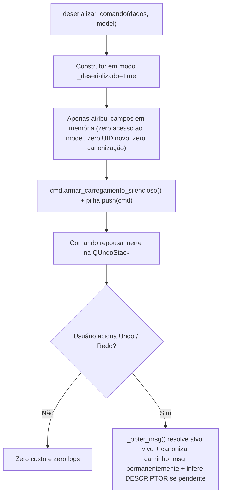

# Design

## Context

Conforme descrito em `proposal.md`, o carregamento de `diario_salvo.bin` ocorre quando o `CroquiModel` já está no estado consolidado final pós-salvamento (`croqui.yaml`), enquanto os registros do diário representam transições históricas intermediárias. Qualquer navegação, validação contra `DESCRIPTOR` ou mutação de `UID` executada durante `deserializar_comando` atua sobre um ponto incorreto da linha do tempo, gerando erros espúrios no Sentry (Issue #103) ou perda de metadados de reversão (`oneof`).

## Goals / Non-Goals

**Goals:**
- Garantir que `deserializar_comando` (nos 7 comandos canônicos e 12 comandos legados) seja uma operação puramente declarativa em $O(1)$ sobre o dicionário lido do `pickle`, com zero acesso ao `CroquiModel`.
- Adiar toda resolução de mensagem alvo, inferência de `modalidade` via `DESCRIPTOR` e canonização permanente de `caminho_msg` para o momento exato de `undo()`, `executar_redo()` ou `mergeWith()`.
- Persistir integralmente transições de `oneof` em `CmdAlterarCampo` para simetria total pós-reabertura.
- Invalidar diários transacionais automaticamente quando `aplicar_migracoes` alterar o croqui em disco.
- Garantir paridade 1:1 entre o Oráculo 1 do Robô Caótico e o `LoggingIntegration` do Sentry, protegida por guarda AST, além de exercitar reabertura de sessão e deserialização real no Oráculo 3.

**Non-Goals:**
- Alterar o formato de framing `pickle` dos arquivos `diario_pendente.bin` e `diario_salvo.bin` (mantendo retrocompatibilidade de leitura com diários existentes que não sofreram migração).
- Introduzir novos comandos canônicos fora dos 7 já estabelecidos.

## Decisions

### 1. Separação Estrita entre Instanciação Ao Vivo e Deserialização Pura (`_modo_deserializacao`)

**Escolha:** Separar explicitamente o fluxo de construção ao vivo (acionado por Controllers/MCP, onde `caminho_msg is None` ou `_deserializado=False`) do fluxo de reconstrução a partir do disco (`deserializar()`, passando `_deserializado=True`):
- **Ao vivo (`_deserializado=False`)**: Executa `validar_pertence_ao_croqui`, infere `modalidade` e valida tipos contra o `DESCRIPTOR` (fail-fast), captura `valor_antigo` / `_var_antiga` / `imagens_removidas_ram` / `bytes_antigos` do modelo vivo e executa `garantir_uids_em_mensagem` sobre novos payloads.
- **Deserialização (`_deserializado=True`)**: Copia exclusivamente os atributos já presentes no dicionário serializado para a instância do comando (`self.model = model`, `self._caminho_msg = ...`, valores deserializados), marcando `self._modalidade_inferida = False` quando os metadados de `modalidade` não vierem prontos do registro. Zero chamadas a `_obter_msg()`, `_validar_campo_se_msg_existir()`, `garantir_uids_em_mensagem()`, `obter_imagens_em_memoria()`, `obter_bytes_imagem()` ou `obter_bytes_anexo()`.

**Alternativas consideradas:**
- *Apenas suprimir o `logger.error` dentro do `__init__`*: Rejeitado. Continuaria pagando o custo de navegação em cada comando do diário no boot, continuaria gerando `UID`s novos em comandos legados sem `UID` e deixaria `self.modalidade` congelada incorretamente como `"primitivo"` quando o alvo estivesse temporariamente ausente no estado final.

### 2. Canonização Permanente *Lazy* em `ComandoEditor._obter_msg()` e Inferência Tardia em `CmdAlterarCampo`

**Escolha:**
- Em `validar_pertence_ao_croqui`: quando `alvo` é passado como `Message`, `resolver_alvo_mensagem` já obtém o identificador ancorado em `UID`; quando passado como `str` posicional (ou deserializado de diário antigo), o comando preserva a string recebida até ser executado, ou resolve na hora da execução. Especificamente em `ComandoEditor._obter_msg()`: ao localizar `alvo` vivo na árvore durante `undo()`, `executar_redo()` ou `mergeWith()`, chama `_canonizar_caminho_se_possivel(root, alvo, indice_uids)`: se `alvo` (ou um ancestral) possuir `uid` preenchido, atualiza `self._caminho_msg` permanentemente para o formato `<uid>` ou `<uid>.<subcaminho>` (mantendo o sufixo da variante `oneof` quando aplicável). Enquanto o comando não for executado, `self._caminho_msg` permanece intocado.
- Em `CmdAlterarCampo`:
  1. `serializar()` passa a gravar `"modalidade": self.modalidade` e, quando `self.modalidade == "oneof"`, grava `"var_antiga"`, `"valor_variante_antiga"`, `"var_nova"` e `"valor_variante_nova"` (serializados via `_serializar_valor`).
  2. Para diários anteriores que ainda não possuíam a chave `"modalidade"` persistida (ou quando `_modalidade_inferida == False`), `_garantir_modalidade_inferida(msg)` inspeciona `msg.DESCRIPTOR` no instante exato em que `_aplicar_mutacao()` obtém a `msg` viva antes de aplicar `undo()` ou `executar_redo()`.

**Alternativas consideradas:**
- *Canonizar todos os comandos durante `carregar_diario_salvo`*: Rejeitado conforme diretriz arquitetural — no estado final consolidado do croqui, um índice posicional antigo (ex: `escaladas.0`) pode apontar para uma entidade *diferente* daquela que ocupava a posição `0` no passado (após reordenações ou exclusões), o que causaria canonização silenciosamente errada! Na hora do `undo()` real, a pilha já desfez os passos posteriores na ordem inversa exata, tornando a resolução posicional e sua canonização 100% determinísticas e corretas.

### 3. Invalidação de Diários em `GerenciadorDiario.invalidar_historico_completo()`

**Escolha:** Adicionar `invalidar_historico_completo()` em `GerenciadorDiario` (truncando/removendo `diario_salvo.bin` e `diario_pendente.bin` e zerando `_cache_salvo` e `_cache_pendente`). Em `JanelaPrincipal.carregar_croqui()`, capturar `migrado = aplicar_migracoes(caminho_db)`: se `migrado` for `True`, obter o `GerenciadorDiario` do workspace e invocar `diario.invalidar_historico_completo()` e `self.historico.limpar()` antes da etapa de leitura dos diários.

### 4. Unificação de Loggers + Guarda AST + Oráculos e Reabertura no Robô Caótico

**Escolha:**
- Substituir todas as ocorrências residuais de `logging.getLogger(...)` em `editor/commands/comandos_protobuf.py`, `editor/commands/comandos_legados.py`, `editor/core/gerenciador_sessao.py`, `editor/plataforma/linux/integracao.py` e `editor/plataforma/linux/portal_keyring.py` por `obter_logger(...)` de `editor.core.registro_log`.
- Adicionar `test_proibicao_instanciacao_logger_fora_de_registro_log` em `editor/arquitetura_mvc_test.py` varrendo a AST de todos os `.py` de produção em `editor/` (exceto `editor/core/registro_log.py`) e falhando caso encontre chamadas a `getLogger` ou `Logger`.
- Em `OraculosCaos.monitorar_excecoes()`: anexar `_HandlerLogErroCaos` no *root logger* (`logging.getLogger()`) e deduplicar caso `propagate` esteja ativo, cobrindo 100% dos loggers do processo assim como o Sentry faz em produção.
- Em `OraculosCaos.verificar_integridade_diario(diario, model=...)`: quando `model` for fornecido, chamar `deserializar_comando(registro, model)` para cada dicionário lido de `diario_pendente.bin` e `diario_salvo.bin`.
- Em `MotorRoboCaoticoQt`: adicionar ações na Fase B para `alterar_estrutura_arvore` (adicionar/remover escalada em setor via `CroquiController` e alternar variante `oneof` de escalada) e `recarregar_sessao_croqui` (invocar `janela.carregar_croqui()` após salvar ou com pendências, ressincronizando o oráculo de simetria para que `Undo`/`Redo` subsequentes auditem os comandos deserializados do disco).

## Risks / Trade-offs

- **[Diários antigos com `CmdAlterarCampo` de `oneof` gravados antes desta correção]** → Para comandos de `oneof` gravados em versões anteriores (que não persistiam `var_antiga`), a inferência tardia via `DESCRIPTOR` identificará `modalidade = "oneof"` sem disparar erro de tipo primitivo, limpando a variante nova no `undo()` caso `var_antiga` seja `None`; todos os novos comandos gravados a partir desta versão terão reversão completa da variante anterior.
- **[Tempo de execução do passo `recarregar_sessao_croqui` no Robô Caótico]** → `carregar_croqui()` relê o YAML local pequeno dos datasets `normal`/`toxico` em `< 15ms`; atribuir peso controlado no sorteio da Fase B mantém alta vazão de sementes na campanha de 5 minutos.
