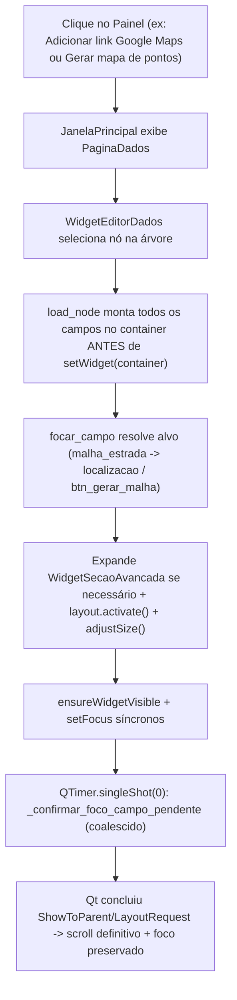

# Design

## Context

Veja `proposal.md` para a motivação do problema. No Editor Desktop Aresta (PySide6), o clique em uma ação rápida do `WidgetPainelQualidade` emite `foco_requisitado` com uma URI `ContextoUIPath`, fazendo `JanelaPrincipal` alternar o `QStackedWidget` para `PaginaDados` e `WidgetEditorDados._on_foco_requisitado` selecionar o nó na árvore e chamar `WidgetFormularioPadrao.focar_campo(nome_campo)`.

Na prática, havia dois atritos combinados:
1. Em `WidgetFormularioPadrao.load_node`, `scroll_area.setWidget(container)` e `self.setCurrentWidget(scroll_area)` ocorriam antes de `_render_message_fields` popular os cards do formulário, e `focar_campo` invocava `ensureWidgetVisible` apenas sincronicamente, enquanto o Qt ainda tinha eventos `ShowToParent`/`LayoutRequest` pendentes (deixando `verticalScrollBar().maximum() == 0` na primeira abertura do nó, na primeira exibição da `PaginaDados` ou ao expandir `WidgetSecaoAvancada`).
2. Na Etapa 1 do `avaliador_nota_qualidade.py`, `etapa1_malha_estrada_picos` era listada em `1.8` (ao final da lista) e emitia `/campo:localizacao`, levando ao `QLineEdit` de Latitude em vez do botão `"Gerar Mapa de Pontos"`.

## Goals / Non-Goals

**Goals:**
- Garantir rolagem e foco confiáveis em `WidgetFormularioPadrao.focar_campo` na primeira navegação para qualquer nó/campo da aba "Dados", na primeira exibição da página de dados e ao expandir `WidgetSecaoAvancada`, sem usar `QApplication.processEvents()`.
- Permitir que `/campo:malha_estrada` role até o campo `localizacao` do `Pico` e foque diretamente `WidgetMensagemCoordenada.btn_gerar_malha` (`"Gerar Mapa de Pontos"`).
- Posicionar `etapa1_malha_estrada_picos` em `1.3` na Etapa 1 e atualizar `COLUNAS_TAREFAS_PAINEL` em `scripts/medir_saude_croquis.py` com proteção contra leitura incremental de cabeçalhos em ordem antiga.

**Non-Goals:**
- Executar a consulta Overpass diretamente pelo Painel de Qualidade sem ir para a aba "Dados" (decisão explícita de manter o fluxo pela aba Dados).
- Alterar o comportamento do card `1.2` quando apenas `url_google_maps` falta (continua exibindo apenas `"Adicionar link Google Maps"`).

## Decisions

### 1. Montagem prévia do container e confirmação coalescida via `QTimer.singleShot(0)`
- **Decisão**: Em `WidgetFormularioPadrao.load_node`, criar `container` e preencher todos os seus widgets (`_render_filename_field`, `oneofs`, `_render_message_fields` e `addStretch()`) **antes** de chamar `scroll_area.setWidget(container)` e `self.setCurrentWidget(scroll_area)`. Em `focar_campo`, extrair `_posicionar_scroll_no_campo(scroll_area, widget_alvo, controle_foco)` (que executa `layout().activate()`, `adjustSize()`, `ensureWidgetVisible` e `setFocus()`), registrar o alvo em `self._foco_campo_pendente` e agendar `QTimer.singleShot(0, self._confirmar_foco_campo_pendente)` (com guarda `shiboken6.isValid`).
- **Alternativas consideradas**:
  - Chamar `QApplication.processEvents()` dentro de `focar_campo`: descartado porque viola o Princípio IX do `AGENTS.md` (proibição explícita de `processEvents()`).
  - Apenas `adjustSize()` sem `QTimer.singleShot(0)`: insuficiente em `QScrollArea` recém-inserido em `QStackedWidget` durante troca de aba, pois o viewport/scrollbar só recalcula `maximum()` após o evento de exibição do Qt no loop.
  - Múltiplos timers independentes sem coalescência: descartado porque chamadas consecutivas no mesmo turno poderiam restaurar foco em um campo anterior; guardar apenas o último `_foco_campo_pendente` e zerá-lo em `load_node` / `descartar_cache_formulario` garante coalescência determinística.

### 2. Mapeamento de `/campo:malha_estrada` em `focar_campo`
- **Decisão**: Como `Pico.malha_estrada` tem `formato_na_ui = INVISIVEL` no `.proto` e sua UI reside dentro de `WidgetMensagemCoordenada` do campo `localizacao`, `focar_campo("malha_estrada")` procura o container de `localizacao` em `self.field_containers` e seleciona prioritariamente `wc.btn_gerar_malha` (quando presente e habilitado) como `controle_foco`. Se o pico ainda não tiver coordenada válida, `avaliador_nota_qualidade.py` continua emitindo `"Adicionar localização"` com `/campo:localizacao` (que foca `edit_lat`).
- **Alternativas consideradas**: Criar um container visual separado para `malha_estrada` no formulário do Pico — descartado por duplicar controles e quebrar o contrato consolidado de `WidgetMensagemCoordenada`.

### 3. Reordenação da Etapa 1 e invalidação de cabeçalho legado em `medir_saude_croquis.py`
- **Decisão**: Mover `t1_malha_estrada` para a 3ª posição de `tarefas_etapa1` em `avaliador_nota_qualidade.py` e alinhar `COLUNAS_TAREFAS_PAINEL` em `scripts/medir_saude_croquis.py` (`1.3 Malha Estrada`, `1.4 Instruções Acesso` .. `1.8 Grau Dificuldade`). Em `extrair_dados_tabela_markdown`, se a linha de cabeçalho lida de um `STATUS_CROQUIS.md` existente não corresponder aos prefixos esperados de `CHAVES_COLUNAS_RELATORIO`, retornar `[]` para que `atualizar_relatorio_saude_croquis` regenere todas as linhas na nova ordem em vez de mapear colunas antigas por índice.
- **Alternativas consideradas**: Manter `1.8 Malha Estrada` no relatório de saúde divergente da ordem do Painel — descartado porque `medir_saude_croquis.py` é explicitamente um espelho 1:1 da ordem e diagnóstico do Painel de Qualidade.

## Risks / Trade-offs

- **[Risk] Destruição do formulário ou troca de nó entre a chamada síncrona de `focar_campo` e o disparo de `QTimer.singleShot(0)`** → **Mitigation**: Zerar `_foco_campo_pendente` em `load_node` e `descartar_cache_formulario`, e validar `shiboken6.isValid` no `scroll_area`, `widget_alvo` e `controle_foco` (além de checar `self.currentWidget() is scroll_area`) dentro de `_confirmar_foco_campo_pendente`.
- **[Risk] Testes existentes de `avaliador_nota_qualidade_test.py` ou `medir_saude_croquis_test.py` acoplados à numeração `1.8` ou URI `/campo:localizacao` da malha** → **Mitigation**: Atualizar e ampliar os testes no ciclo Red-Green antes da implementação.
