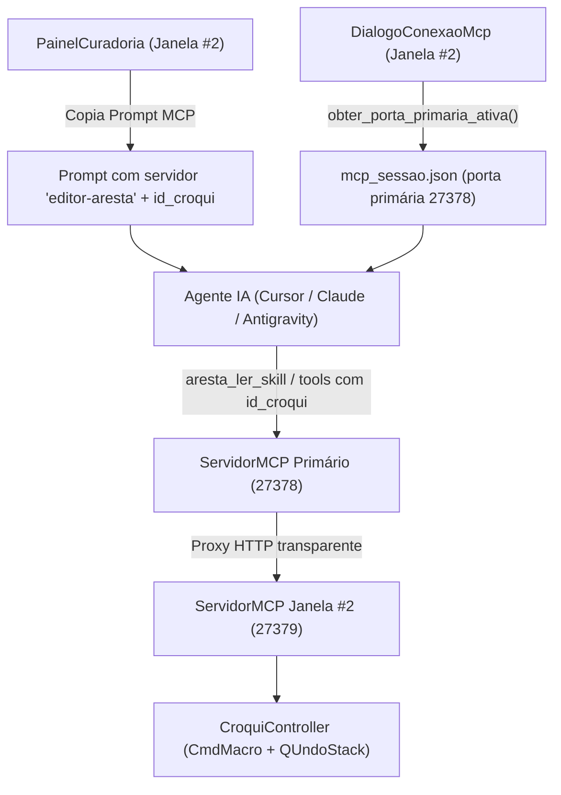

# Design

## Context

O suporte a múltiplas janelas do Editor Aresta introduziu travas por croqui (`ArestaEditorCroqui_<id_croqui>`) e roteamento proxy HTTP transparente a partir da sessão primária registrada em `mcp_sessao.json` (`27378`), exigindo o parâmetro `id_croqui` nas chamadas MCP quando mais de um croqui está aberto (`ServidorMCP._resolver_guarda_ou_roteamento_croqui`). Contudo, três lacunas permaneciam no fluxo de curadoria e conexão MCP (ver `proposal.md`):

1. O banner e o texto copiado por `PainelCuradoria._copiar_prompt_mcp` eram estáticos (`"...deste croqui"`), omitindo o servidor `editor-aresta`, `aresta_ler_skill` e `id_croqui`.
2. `JanelaPrincipal._exibir_conexao_mcp` e `TelaDeCarregamento.ao_clicar_conectar_mcp` passavam `servidor.porta` diretamente ao `DialogoConexaoMcp`, exibindo a porta secundária (`27379+`) em janelas adicionais em vez da porta primária de `mcp_sessao.json`.
3. O protocolo MCP não possuía operações dedicadas endereçadas por `(escalada_uid, url)` para inserir candidatos externos na revisão nem remover betas com bloqueio em `betas_rejeitados`.

## Goals / Non-Goals

**Goals:**
- Garantir que o prompt MCP copiado na aba **Betas** funcione em cenários multi-janela e em qualquer cliente MCP (dentro ou fora do repositório `aresta_db`).
- Garantir que o `DialogoConexaoMcp` aponte sempre para a porta da sessão primária ativa (`mcp_sessao.json`) quando existir, usando a porta local apenas como fallback.
- Expor `aresta_adicionar_betas_revisao` e `aresta_remover_betas` sobre métodos atômicos e reversíveis (`CmdMacro` / `QUndoStack`) no `CroquiController`, reutilizando `normalizar_url` e `classificar_fonte_url`.
- Alinhar as skills `avaliar_betas_croqui`, `coletar_betas_croqui` e `resolver_feedback_croqui` em PT-BR com 100% de cobertura comportamental nos módulos alterados.

**Non-Goals:**
- Não alterar a semântica de aprovação em lote (`>= 80%`) na UI do `PainelCuradoria`.
- Não alterar o formato de persistência em disco de `curadoria_betas.yaml` nem tornar `curadoria_betas` visível em `aresta_obter_arvore`.

## Decisions

### 1. Fluxo Multi-Janela e Roteamento da Curadoria MCP

- **Resolução da porta primária em `editor/mcp/sessao.py`**: criar `obter_porta_primaria_ativa(porta_fallback=None, diretorio_base=None) -> tuple[int, bool]`. Quando `ler_sessao_mcp(diretorio_base)` retornar uma sessão ativa, retorna `(sessao.porta, True)`; caso contrário, usa `porta_fallback` com `True` ou `(PORTA_MCP_PADRAO, False)`. Isso evita acoplar o `DialogoConexaoMcp` à instância local da janela secundária, preservando o contrato quando uma porta explícita é passada diretamente em testes unitários.
- **Prompt sempre focado no croqui inteiro em `PainelCuradoria`**: mesmo quando `combo_escalada` estiver filtrado em uma via específica, `_copiar_prompt_mcp` gera o prompt para todos os `betas_nao_scorados` do croqui (`id_croqui` + `nome_croqui`), destravando a fila completa do croqui para a Etapa 2 do painel de qualidade.

### 2. Métodos de Curadoria no `CroquiController` e Ferramentas MCP

- **`CroquiController.adicionar_betas_para_revisao(itens, context_path=None)`**:
  - **Alternativa descartada**: exigir criação prévia de `CuradoriaBetasEscalada` ou aceitar `aresta_adicionar_repeated` direto em `curadoria_betas`. Descartado porque `curadoria_betas` é `INVISIVEL` no MCP, exige normalização de URL, inferência de `FonteMidia`, ordenação decrescente em `betas_nao_revisados` e limpeza de prefixo `[Query: ... | Auto-filtrado: ...]`.
  - **Contrato escolhido**: recebe lista de itens `{escalada_uid, url, titulo?, fonte?, snippets?, llm_confidence_score?, llm_reasoning?}`. Valida tudo antecipadamente (*fail-fast*): `escalada_uid` válida, URL normalizada não vazia, `fonte` válida ou inferida via `classificar_fonte_url`, e par completo `(llm_confidence_score, llm_reasoning)` ou ambos ausentes. Se já estiver em `Escalada.betas`, contabiliza `ja_aprovados` sem duplicar. Se estiver em `betas_rejeitados` (seja auto-filtrado ou rejeição manual), remove de `betas_rejeitados` e move de volta para revisão. Se já estiver em `betas_nao_scorados` ou `betas_nao_revisados`, atualiza/promove mesclando `titulo` e `snippets` sem duplicar. Tudo em um único `CmdMacro` (`"Adicionar Betas para Revisão"`).
- **`CroquiController.remover_betas_por_url(itens, bloquear_futura_coleta=True, context_path=None)`**:
  - **Alternativa descartada**: usar `aresta_remover_repeated` em `Escalada.betas` por índice. Descartado porque índices são frágeis e `aresta_remover_repeated` não registra a URL em `betas_rejeitados`, fazendo a mídia retornar na próxima coleta.
  - **Contrato escolhido**: recebe lista de itens `{escalada_uid, url, bloquear_futura_coleta?}`. Valida previamente que cada `(escalada_uid, url_norm)` existe em `Escalada.betas`, `betas_nao_revisados` ou `betas_nao_scorados` (ou em `betas_rejeitados` quando `bloquear_futura_coleta=False`), lançando `ValueError` caso contrário. Remove das listas aplicáveis e, quando `bloquear_futura_coleta=True`, registra `MidiaBeta` em `betas_rejeitados` em um único `CmdMacro` (`"Remover Betas"`).

## Risks / Trade-offs

- **Risco**: `classificar_fonte_url` retornar `None` para URLs genéricas de perfil sem post específico (ex.: `https://instagram.com/escalador`) quando o usuário quiser adicionar manualmente → **Mitigação**: aceitar `fonte` explícita opcional (ex.: `"INSTAGRAM"` ou `"BLOG"`) para contornar casos em que a heurística de path restrita retorna `None`, falhando explicitamente apenas quando nem `fonte` válida for informada nem `classificar_fonte_url` conseguir inferir.
- **Risco**: Uso indevido de `aresta_remover_betas` durante avaliação autônoma em lote → **Mitigação**: reforçar explicitamente nas instruções da ferramenta e no `[!CAUTION]` de `avaliar_betas_croqui/SKILL.md` que `aresta_remover_betas` só deve ser usada sob solicitação explícita do usuário/mantenedor.
