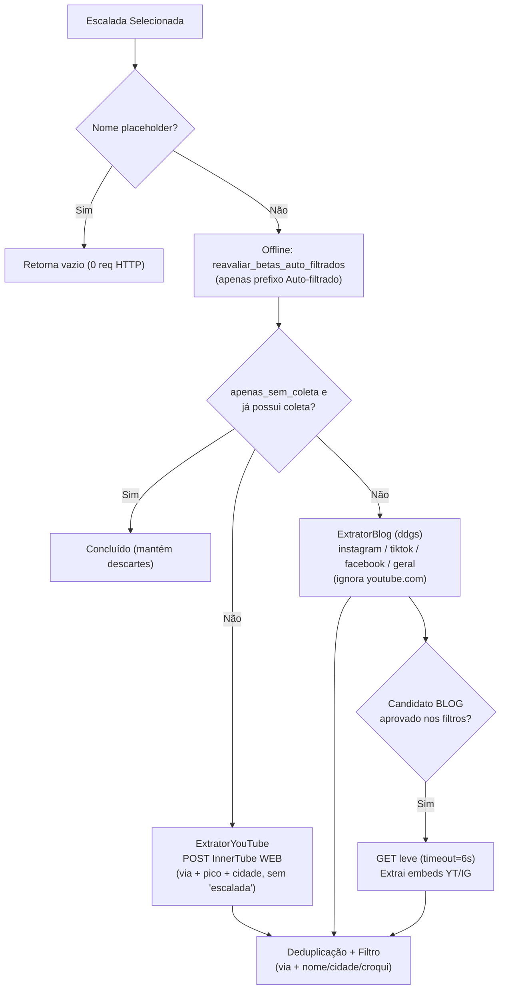

# Design: Otimização de Pipeline de Curadoria, MCP e Coleta de Betas

## Context

Este documento detalha a arquitetura de solução para os problemas levantados em [proposal.md](proposal.md). As mutações do Editor Aresta devem respeitar estritamente a arquitetura MVC com comandos na pilha `QUndoStack`, despacho seguro para a thread principal do Qt (`DespachanteQt`), e testes 100% determinísticos sem mocks internos (`AGENTS.md`). O schema `beta.proto` no submódulo `aresta_api` permanece inalterado.

## Goals / Non-Goals

**Goals:**
- Reduzir de segundos (`~5,4s`) para milissegundos (`< 200ms`) lotes de mutação sobre dezenas de entradas de `curadoria_betas`.
- Eliminar respostas *split-brain* no `DespachanteQt` quando uma execução já iniciou na thread principal do Qt.
- Tornar a etapa de pontuação via MCP enxuta, atômica e imune a perda de `snippets` com `aresta_pontuar_betas`.
- Separar a extração de vídeos do YouTube (`InnerTube` JSON) das buscas `ddgs` (`ExtratorBlog`), aumentar revocação com contexto geográfico (`Pico.cidade`, `Croqui.nome`, `"complexo"`) e embeds em blogs aprovados, evitar requisições inúteis em vias placeholder e resgatar itens `[Auto-filtrado: ...]` offline antes da coleta.

**Non-Goals:**
- Alterar arquivos `.proto` em `aresta_api` ou criar novo campo booleano no `MidiaBeta`.
- Alterar a coalescência time-sliced existente em `PainelCuradoria._ao_alterar_indice_undo`, que já agrupa múltiplas mutações síncronas em uma única reconstrução.
- Introduzir dependências pagas ou chaves de API externas para o YouTube.

## Decisions

### 1. Reuso de Caminho Canônico $O(1)$ e Reindexação Seletiva de UIDs
Em lotes sobre `CuradoriaBetasEscalada`, `resolver_alvo_mensagem` percorria o `Croqui` inteiro para cada subcomando criado porque `CroquiController._construir_comandos_para_alvo`, `adicionar_multiplos_repeated` e `alterar_multiplos_repeated_items` repassavam o objeto `Message` em vez da string `caminho_res` já validada por `validar_pertence_ao_croqui`. Em paralelo, `CroquiModel` reconstruía o `IndiceUidsModel` inteiro para qualquer coleção `repeated`, inclusive `betas_nao_scorados` e `betas_nao_revisados`.

- **Decisão**: Passar `alvo=caminho_res` (`str`) para todos os subcomandos gerados em `_construir_comandos_para_alvo`, `adicionar_multiplos_repeated` e `alterar_multiplos_repeated_items`, e restringir `carregar_do_croqui` no `CroquiModel` apenas a coleções pertencentes a `CAMPOS_REPEATED_COM_UID_INDEXADO` (`botoes`, `picos`, `setores_ou_grupos`, `setores`, `escaladas`, `enfiadas`). Na camada MCP (`ferramentas_comandos.py`), reindexar apenas quando algum campo alterado puder modificar UIDs ou nomes indexados.
- **Alternativa considerada**: Manter reconstrução incondicional no fim de cada macro MCP — rejeitada porque comandos internos ainda pagariam $O(\text{Croqui})$ em mutações diretas da UI ou controller.

### 2. Separação entre Timeout de Fila e Timeout de Execução no `DespachanteQt`
```mermaid
sequenceDiagram
    participant MCP as Thread Uvicorn MCP
    participant DQ as DespachanteQt
    participant QT as Thread Principal Qt
    MCP->>DQ: executar(fn, timeout=10s, timeout_execucao=60s)
    DQ->>QT: emit _sinal_executar(futuro, fn)
    MCP->>DQ: futuro.result(timeout=10s)
    alt Timeout expirou antes de iniciar na thread Qt
        DQ->>DQ: futuro.cancel() == True
        DQ-->>MCP: TimeoutError (fila bloqueada; nada mutado)
    else Já iniciou na thread Qt (RUNNING)
        DQ->>DQ: futuro.cancel() == False
        DQ->>DQ: aguarda futuro.result(timeout=timeout_execucao)
        QT-->>DQ: resultado ou exceção real
        DQ-->>MCP: retorna resultado cometido (sem split-brain)
    end
```

- **Decisão**: Introduzir `timeout_execucao: float | None = None` (padrão `60.0s`) separado do `timeout` inicial de enfileiramento (`10.0s`). Quando `futuro.cancel()` retornar `False` porque a thread Qt já começou a executar a função, o despachante aguarda até `timeout_execucao` e retorna o valor ou exceção real.
- **Alternativa considerada**: Apenas aumentar `timeout=60s` globalmente — rejeitada pois esconderia travamentos reais da fila GUI (onde a tarefa ainda está `PENDING` e pode ser cancelada com segurança em 10s).

### 3. Ferramenta Dedicada `aresta_pontuar_betas` sobre `CroquiController.pontuar_betas_em_lote`
- **Decisão**: Criar `CroquiController.pontuar_betas_em_lote(escaladas)` recebendo `{escalada_uid, avaliacoes: [{url, llm_confidence_score, llm_reasoning}]}`, validando integralmente *fail-fast* antes de empilhar comandos, preservando `midia`, `snippets` e flags diretamente dos objetos em RAM, mesclando e ordenando `betas_nao_revisados` em ordem decrescente de score, e executando via um único `CmdMacro`. Expor como `aresta_pontuar_betas` em `editor/mcp/ferramentas_betas.py`.
- **Alternativa considerada**: Continuar usando `aresta_alterar_em_lote` com objetos inteiros serializados — rejeitada por duplicação massiva de payload e risco de perda de `snippets`.

### 4. Arquitetura Dual de Coleta: YouTube `InnerTube` + `ddgs` sem YouTube + Reavaliação Offline


- **Decisão**:
  - `ExtratorYouTube` usa endpoint público JSON `InnerTube` (`POST https://www.youtube.com/youtubei/v1/search?prettyPrint=false`) com cliente `primp` em sessão Windows/Chrome e controle de cadência (*pacing* padrão `0.4s` por host), sem exigir chave da Data API v3 nem incluir `"escalada"` obrigatória na query.
  - `ExtratorBlog` executa 4 queries `ddgs` (`instagram`, `tiktok`, `facebook`, `geral`) e descarta qualquer resultado classificado como `FonteMidia.YOUTUBE`, eliminando ruído de carrosséis do Yahoo e evitando duplicidade com o `ExtratorYouTube`.
  - Contexto geográfico (`menciona_contexto_local`) unifica tokens significativos de `Pico.nome`, `Pico.cidade` e `Croqui.nome`, com `"complexo"`, `"area"`, `"regiao"` e `"nucleo"` em `STOPWORDS_PICO`.
  - `Extrações de Embeds`: realizada somente sobre URLs `FonteMidia.BLOG` já validadas nos filtros de relevância; falhas transitórias de GET em blogs externos não invalidam o candidato `BLOG` original (tolerância explícita documentada em spec).
  - Itens descartados por filtro automático mantêm o prefixo `[Query: <origem> | Auto-filtrado: <motivo>] <titulo>` em `betas_rejeitados`, distinguindo-os deterministicamente de rejeições humanas (título limpo) sem necessidade de modificar `beta.proto`.

## Risks / Trade-offs

- **Alteração de contrato do `InnerTube` pelo YouTube** → Mitigação: parser defensivo por chave de renderer (`videoRenderer`, `reelItemRenderer`, `shortsLockupViewModel`), pacing configurável (`intervalo_minimo_s=0.4`) e cliente TLS compatível (`primp`), com falha explícita (`RuntimeError`) em respostas não-200 ou erro de transporte.
- **Latência adicional do GET HTML em blogs aprovados (D4)** → Mitigação: executado exclusivamente após aprovação pelos filtros de via e contexto local, somente para `FonteMidia.BLOG` (fração minoritária das URLs), com timeout curto (`6s`).
- **Mudança de assinatura de `ExtratorYouTube.__init__`** → Mitigação: verificado via `git grep` que `ExtratorYouTube` não tinha chamadores fora de `coleta_de_betas/extratores/youtube_test.py` (corte limpo conforme Princípio VIII).
