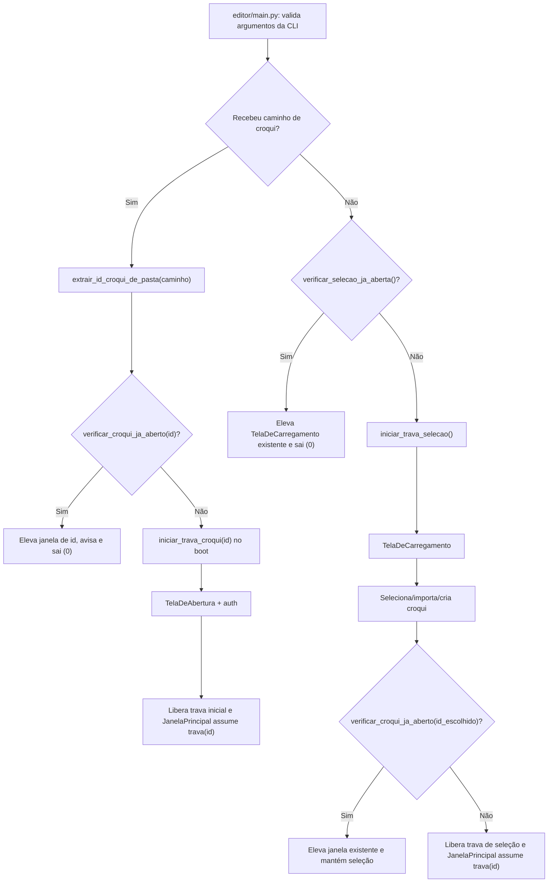

# Design

## Context

Veja `proposal.md` para a motivação. Embora `editor/core/instancia_unica.py` já contasse com `obter_nome_servidor_croqui`, `verificar_croqui_ja_aberto` e `iniciar_trava_croqui`, nenhuma chamada de produção utilizava essas funções: `editor/main.py` ainda validava e registrava a trava global `NOME_SERVIDOR_PADRAO` antes mesmo de interpretar o caminho do croqui na linha de comando.

## Goals / Non-Goals

**Goals:**
- Permitir múltiplos processos simultâneos do Aresta Editor (`uv run editor/main.py <croqui>`), um por `id_croqui` distinto.
- Garantir no máximo uma janela ativa por `id_croqui` (elevando especificamente a janela daquele croqui quando houver tentativa de reabertura) e no máximo uma `TelaDeCarregamento` aguardando seleção sem croqui.
- Serializar recursos compartilhados entre processos independentes (`mcp_sessoes.json`/`mcp_sessao.json`, repositório Git `aresta_db`, saída `generated/` e `STATUS_CROQUIS.md`).
- Isolar nomes de servidores IPC nos testes automatizados via variável de ambiente `ARESTA_PREFIXO_IPC`.

**Non-Goals:**
- Delegar abertura de janelas de um processo CLI para outro processo já aberto (arquitetura estilo servidor único); cada invocação CLI permanece em seu próprio processo isolado.
- Permitir duas janelas editando simultaneamente o mesmo `id_croqui`.

## Decisions

### 1. Fluxo de Travas IPC no Arranque e Transição de Janelas

- **Por que transferir a trava para `JanelaPrincipal`?**
  - Se um usuário abrir por `TelaDeCarregamento` ou clicar em "Abrir Novo" (retornando para `TelaDeCarregamento`), ou ainda renomear o `id` do croqui durante um salvamento, apenas a `JanelaPrincipal` conhece o `id_croqui` vivo e sua própria referência (`self`) para `ativar_janela_existente(self)`.
  - No Windows, `QLocalServer` usa named pipes em escopo de usuário; portanto `ControladorAplicativo` encerra explicitamente `app.servidor_local` imediatamente antes de instanciar a `JanelaPrincipal` no modo local para que `JanelaPrincipal` assuma o pipe `ArestaEditorCroqui_<id>` sem conflito.
  - Em `JanelaPrincipal`, `ativar_trava_croqui` segue por padrão `iniciar_rede_mcp` (mantendo testes unitários isolados sem interferência cruzada entre workers, mas habilitado explicitamente em produção pelo `main()`).

### 2. Isolamento de Testes via `ARESTA_PREFIXO_IPC`

- **Decisão**: `obter_nome_servidor_selecao()` e `obter_nome_servidor_croqui(id_croqui)` prefixam os nomes de servidor quando `ARESTA_PREFIXO_IPC` está definida no ambiente.
- **Alternativa rejeitada**: Parametrizar manualmente o prefixo por dezenas de assinaturas de UI (`TelaDeCarregamento`, `JanelaPrincipal`, `main`). Uma variável de ambiente preserva assinaturas limpas em produção e garante isolamento determinístico em testes `pytest` paralelos.

### 3. Proteção Atômica de Sessões MCP e Escritas Compartilhadas

- **`editor/mcp/sessao.py`**: `trava_arquivo_operacao` não é reentrante, portanto `gravar_sessao_mcp`, `registrar_sessao_multi_mcp` e `desregistrar_sessao_multi_mcp` adquirem uma única vez `.lock` de `mcp_sessoes.json` e manipulam `mcp_sessoes.json` e `mcp_sessao.json` usando helpers internos sem lock. `gravar_sessao_mcp` só sobrescreve `mcp_sessao.json` caso não exista outra sessão ativa listada em `mcp_sessoes.json` para a porta primária atual.
- **`editor/core/sync.py`**: Lockfile externo ao repositório (`.<nome_repo>_git.lock` em `caminho_repo.parent`) para não poluir `caminho_repo` antes de `pygit2.init_repository` nem disparar falsos positivos em `any(caminho_repo.iterdir())`.
- **`editor/core/workspace.py`**: Lockfile `compilacao_local.lock` gravado em `gerenciador_caminhos.obter_diretorio_base()` (diretório de dados do aplicativo, nunca dentro do repositório Git) para serializar `git mv`, `deploy` em `generated/` e atualização de `STATUS_CROQUIS.md`.

## Risks / Trade-offs

- **[Risco] Deadlock por aquisição reentrante de `trava_arquivo_operacao` em `sessao.py`** → **Mitigação**: Isolamento estrito de helpers privados sem lock e testes dedicados de gravação/atualização/promoção multi-sessão.
- **[Risco] Disputa na transição da trava no Windows entre `main()` e `JanelaPrincipal` no mesmo processo** → **Mitigação**: Encerramento explícito de `app.servidor_local` via `encerrar_servidor_local` antes da instanciação de `JanelaPrincipal`, coberto por teste de integração completo.
- **[Risco] Colisão de pipes nomeados entre suítes de testes e uma instância real aberta pelo usuário** → **Mitigação**: Uso sistemático de `ARESTA_PREFIXO_IPC` nos testes novos e refatorados de `instancia_unica_test.py`, `tela_de_carregamento_test.py`, `area_principal_test.py` e `main_test.py`.
