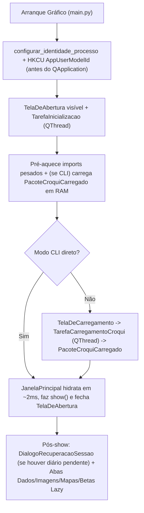

# Design

## Context

Conforme detalhado em `proposal.md`, três problemas afetam a experiência atual do Editor Aresta:
1. O banner amarelo de `1. Betas Não Scorados` em `PainelCuradoria` renderiza o prompt técnico completo de 6 linhas diretamente na interface.
2. Em execuções via Python desempacotado no Windows 11 (`uv run editor/main.py ...`), `configurar_identidade_processo` é disparado em tempo de `import` de `editor/main.py` (poluindo o cache do Shell durante `pytest`/`--headless`), o `AppUserModelID` customizado (`aresta.editor.v1` / `aresta.editor.beta`) não possui registro visual em `HKCU\Software\Classes\AppUserModelId`, e chamadas `setWindowFlags` / `SetWindowLongW` ocorrem após `setWindowIcon` sem reforçar `WM_SETICON`.
3. Na transição para `JanelaPrincipal`, a tela anterior fecha antes da carga pesada, bloqueando a UI thread por ~2,1s–5,0s (imports tardios, leitura/parse de YAML e `.md`, `git rev-parse HEAD`, construção ansiosa de `WidgetEditorDados`/`WidgetEditorImagens`, avaliação repetida de `nota_qualidade` e `sleep` de espera do Uvicorn).

Restrições inegociáveis (`AGENTS.md` e `editor-plataforma-abstracao`):
- Qualquer acesso a APIs nativas do Windows (`ctypes.windll`, `winreg`) deve permanecer estritamente confinado a `editor/plataforma/windows/`.
- A thread principal do Qt jamais deve ser bloqueada além do orçamento de meio frame e é proibido usar `QApplication.processEvents()` como muleta.
- Objetos `QObject` (`CroquiModel`) devem ser instanciados na thread principal do Qt; worker threads manipulam apenas estruturas Python/Protobuf puras.

## Goals / Non-Goals

**Goals:**
- Tornar o banner de `1. Betas Não Scorados` enxuto (apenas 2 passos curtos), preservando o prompt MCP contextualizado completo exclusivamente no botão **"📋 Copiar Prompt MCP"**.
- Garantir aplicação 100% confiável do ícone oficial do Aresta na barra de título e na barra de tarefas do Windows 11 tanto em pacotes MSIX/PyInstaller quanto via `uv run`.
- Mover toda a carga pesada de disco, Protobuf, Git e avaliação inicial de qualidade para background (`TarefaInicializacao` no modo CLI direto e `TarefaCarregamentoCroqui` na seleção via `TelaDeCarregamento`), mantendo `PaginaDados` e `PaginaImagens` sob demanda (*lazy*) e eliminando o intervalo sem janela visível.

**Non-Goals:**
- Alterar o formato dos arquivos `croqui.yaml`, `.md` ou `curadoria_betas.yaml` em disco.
- Alterar o contrato JSON-RPC externo das ferramentas do servidor MCP `editor-aresta`.

## Decisions

### 1. Separação entre texto do banner e prompt copiado no `PainelCuradoria`
- **Decisão**: `gerar_instrucoes_banner_mcp_avaliacao(id_croqui, nome_croqui)` retornará apenas 2 linhas instrutivas para humanos (conectar ao `editor-aresta` pelo botão ao lado e clicar em **"📋 Copiar Prompt MCP"** para colar o comando no agente, mencionando opcionalmente o nome do croqui de forma limpa), sem concatenar `gerar_prompt_mcp_avaliacao_betas(...)`. `_copiar_prompt_mcp()` continuará copiando `gerar_prompt_mcp_avaliacao_betas(...)` integralmente.
- **Alternativa descartada**: Colocar o prompt em um `QCollapsible`/expando secundário dentro do banner — adiciona ruído desnecessário já que o usuário nunca edita esse prompt manualmente antes de copiar.

### 2. Identidade de processo e ícone determinístico no Windows via `editor.plataforma`
- **Decisão**:
  1. Remover a chamada em nível de módulo `configurar_identidade_processo(...)` de `editor/main.py` e invocá-la apenas dentro de `main()` (no fluxo gráfico real, antes de `QApplication(sys.argv)`), evitando que `pytest` ou `--headless` registrem um `python.exe` sem ícone sob `"aresta.editor.v1"`.
  2. Estender `configurar_identidade_processo(identificador_app, nome_exibicao="", caminho_icone=None)` e `aplicar_icone_janela_nativa(identificador_janela, caminho_icone)` na fachada `editor.plataforma` (`AdaptadorPlataforma`, `AdaptadorWindows`, `AdaptadorLinux`, `AdaptadorMacOS`, `_AdaptadorPadraoFallback` e `AdaptadorPlataformaFake`):
     - No Windows fora de MSIX: tipar `SetCurrentProcessExplicitAppUserModelID` (`argtypes = [ctypes.c_wchar_p]`, `restype = ctypes.HRESULT`) e gravar `DisplayName` + `IconUri` em `HKCU\Software\Classes\AppUserModelId\<identificador_app>` via `winreg` (injetável por um protocolo/fachada Win32 com `ApiWin32Fake` determinístico para testes sem `MagicMock`).
     - Em `aplicar_icone_janela_nativa` / `configurar_presenca_barra_de_tarefas`: carregar handles `HICON` (`IMAGE_ICON`, `16x16` e `32x32`/`256x256` via `LoadImageW` com `LR_LOADFROMFILE | LR_SHARED`) e enviá-los via `SendMessageW(hwnd, WM_SETICON, ICON_SMALL / ICON_BIG, hicon)` além de `SetWindowPos(..., SWP_FRAMECHANGED)` após ajustar `GWL_STYLE`/`GWL_EXSTYLE`.
  3. Garantir que `setWindowFlags` venha sempre antes de `setWindowIcon` em `TelaDeCarregamento`, `TelaDeAbertura` e `DialogoRecuperacaoSessao`.

### 3. Biblioteca `carregador_croqui.py` (Protobuf puro em background) + Abas Lazy
- **Decisão**:
  - Criar `editor/core/carregador_croqui.py` contendo `PacoteCroquiCarregado` (dataclass com `caminho_db`, `croqui_data`, `croqui_msg`, `houve_migracao`, `snapshots_arquivos_externos`, `commit_base_sha`, `resultado_qualidade_inicial`) e `carregar_pacote_croqui(caminho_db, obter_commit_sha=...)`.
  - Como `CroquiModel` é um `QObject`, `carregar_pacote_croqui` constrói e hidrata apenas a mensagem Protobuf pura (`Croqui`) e dicionários/snapshots Python (thread-safe para rodar em `QThread`), usando a mesma lógica de leitura de `.md`/`.yaml` do `CroquiModel`. Na UI thread, `CroquiModel.criar_de_pacote_carregado(pacote)` apenas envolve `pacote.croqui_msg` e reconstrói `IndiceUidsModel` em memória (`~1-2 ms`, zero I/O de disco!).
  - Na `TarefaInicializacao` (`editor/core/worker.py`):
    - Sempre executa `pre_aquecer_modulos_janela_principal()` na worker thread (importando `area_principal`, `workspace`, `ServidorMCP`, etc. fora da UI thread enquanto a `TelaDeAbertura` está visível).
    - Quando `caminho_croqui_local` é fornecido, `TarefaInicializacao` já executa `carregar_pacote_croqui(...)` na mesma thread e armazena `self.pacote_croqui_inicial`.
  - Na `TelaDeCarregamento`: ao abrir um croqui existente (`ao_clicar_item`), executa `TarefaCarregamentoCroqui` (`QThread`) mantendo feedback visual no diálogo e só aceita o diálogo quando o `PacoteCroquiCarregado` já está pronto em memória.
  - Em `ControladorAplicativo`: `mostrar_janela_principal()` instancia `JanelaPrincipal(..., pacote_croqui=...)`, chama `janela_principal.show()`, fecha `self.abertura` (se ainda visível) sem buraco visual, e dispara eventual verificação/diálogo de recuperação de `diario_pendente.bin` (`executar_pos_exibicao()`) já com a `JanelaPrincipal` visível!
  - Em `JanelaPrincipal`:
    - `PaginaDados` e `PaginaImagens` passam a ter `garantir_editor_criado()` (exatamente como `PaginaMapas` e `PaginaBetas`), mantendo compatibilidade total com navegadores de contexto (`_on_foco_requisitado`), `salvar_croqui` e ferramentas MCP (`_obter_widget_alvo_mcp` / `_obter_selecao_mcp`).
    - `WidgetPainelQualidade.set_model_e_controller` aceita `resultado_inicial: ResultadoNotaQualidade | None = None` para evitar recalcular `MessageToDict` na abertura quando o pacote já trouxe o cálculo pronto (exceto se o diário restaurar comandos pendentes, caso em que recalcula).
    - `ServidorMCP.iniciar(aguardar_pronto=False)` é usado na abertura da `JanelaPrincipal` (o socket TCP `vincular_socket_mcp` e `mcp_sessao.json` já são vinculados sincronamente antes da thread Uvicorn subir, então a porta já é conhecida imediatamente sem precisar de `while not self._server.started: time.sleep(0.01)` na UI thread!).

## Risks / Trade-offs

- **[Acessos externos a `pagina_dados.editor_dados` ou `pagina_imagens.editor` antes de abrir a aba]** → Mitigação: expor propriedades/métodos `garantir_editor_criado()` em `PaginaDados` e `PaginaImagens` (e manter property `editor` em `PaginaImagens` instanciando sob demanda caso acessada diretamente por testes legados ou salvar/MCP), garantindo zero quebra de contrato.
- **[Recuperação de `diario_pendente.bin` alterando o modelo após o cálculo inicial de qualidade]** → Mitigação: quando `restaurar_do_diario` aplicar comandos pendentes pós-`show()`, `WidgetPainelQualidade` recebe automaticamente os sinais de mutação coalescidos (ou é atualizado ao final da restauração), mantendo a nota 100% fiel.
- **[Socket MCP consultado imediatamente após `JanelaPrincipal(...)`]** → Mitigação: `vincular_socket_mcp` faz `bind()` e `listen()` no kernel antes de `uvicorn.Server.run(sockets=[sock])`, de modo que o kernel já enfileira conexões TCP imediatamente na porta gravada em `mcp_sessao.json` mesmo com `aguardar_pronto=False`, e `ServidorMCP.esta_ativo` reflete a thread viva + sessão ativa.
