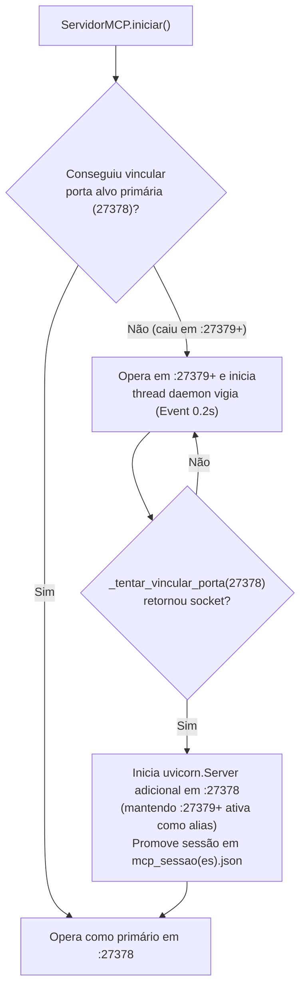

# Design

## Context

Conforme descrito em `proposal.md`, clientes MCP baseados em HTTP/SSE (`Antigravity`, `Codex`, `Cursor`) utilizam URL estática (`http://127.0.0.1:27378/mcp`). Hoje, cada `ServidorMCP` vincula apenas um socket inicial (`27378` para a 1ª janela; `27379+` para as demais) e nunca reavalia a disponibilidade da porta primária `27378`. Além disso, `mcp_sessoes.json` e `mcp_sessao.json` não sofrem saneamento ativo quando um processo morre sem executar `parar()`, `_encaminhar_via_proxy` bombeia `QCoreApplication.processEvents()` mesmo em threads de background (violando o Princípio IX do `AGENTS.md`) sem tratar falhas de rede, e `ControladorAplicativo` não promove `janelas_secundarias` quando `janela_principal` é fechada individualmente pelo usuário.

## Goals / Non-Goals

**Goals:**
- Garantir que a porta primária (`27378` ou `ARESTA_MCP_PORTA`) volte automaticamente a responder por uma janela sobrevivente em menos de `1s` após o fechamento normal ou morte abrupta (`kill`) da janela primária, tanto entre processos distintos quanto no mesmo processo.
- Podar deterministicamente sessões mortas de `mcp_sessoes.json` e `mcp_sessao.json` sem introduzir latência perceptível nem tocar na thread de UI do Qt.
- Manter zero dependências externas novas, 100% de cobertura comportamental e conformidade integral com os 10 princípios do `AGENTS.md`.

**Non-Goals:**
- Introduzir um processo daemon externo independente do ciclo de vida das janelas do Editor Aresta.
- Exigir que o usuário altere configurações existentes em `mcp_config.json`, `.cursor/mcp.json` ou `.codex/config.toml`.

## Decisions

### 1. Eleição e Reaquisição da Porta Primária por Socket Exclusivo (`ServidorMCP`)

- **Escolha**: Quando `ServidorMCP.iniciar()` obtém uma porta secundária (`porta != porta_alvo_primaria`, onde `porta_alvo_primaria` é `porta_preferencial`, `ARESTA_MCP_PORTA` ou `27378`), ele inicia uma thread daemon leve controlada por um `threading.Event` (`intervalo_vigia_primaria_s = 0.2`). A cada pulso, a vigia chama `vincular_porta_especifica_mcp(porta_alvo_primaria)` (baseada em `bind` local com `SO_EXCLUSIVEADDRUSE` no Windows, custo de microssegundos no kernel e zero tráfego de rede).
- Quando a janela primária encerra ou sofre `kill`, o SO libera o descritor do socket `27378`. Exatamente uma janela sobrevivente vence o `bind` exclusivo, instancia um segundo `uvicorn.Server` servindo o mesmo `self.app` sobre o socket `27378` (mantendo o listener secundário `27379+` aberto até `parar()` para não interromper clientes que já usassem a porta secundária) e chama `promover_sessao_para_porta_primaria_mcp(...)` sob lock de arquivo, substituindo tanto a entrada morta de `27378` quanto sua entrada anterior de `27379+` em `mcp_sessoes.json` e atualizando `mcp_sessao.json`.
- **Alternativas consideradas**:
  - *Reiniciar o `ServidorMCP` fechando `27379` para abrir `27378`*: descartada, pois derrubaria conexões SSE ou chamadas em voo que estivessem usando `27379`.
  - *Migrar clientes para `stdio` (`editor.mcp.bridge`)*: descartada como solução única porque pacotes GUI Windows MSIX rodam com `console=False` (`stdin`/`stdout` nulos) e obrigaria todos os usuários a reconfigurar seus agentes.

### 2. Saneamento de Sessões Órfãs por Verificação de Vinculação de Porta (`sessao.py`)

- **Escolha**: Evitar `os.kill(pid, 0)` (que no Windows envia `CTRL_C_EVENT` ao processo!) e evitar `TCP connect` em portas mortas (que no Windows pode sofrer retransmissão `SYN` de `1s–2s`). Como todo `ServidorMCP` ativo mantém `bind` exclusivo em `127.0.0.1:<porta>`, `porta_disponivel_local(porta)` verifica no kernel em microssegundos se existe listener ativo: se a porta está livre (`True`), aquela sessão de rede morreu.
- Criamos `listar_sessoes_mcp_ativas(diretorio_base, porta_local_ativa=...)` em `editor/mcp/sessao.py`: quando invocada a partir de um servidor de rede ativo (ou da ponte `stdio` / resolução de porta primária quando há sessões com socket vinculado), filtra e remove atomicamente de `mcp_sessoes.json` quaisquer entradas órfãs cujas portas estejam livres no SO, sincronizando `mcp_sessao.json` para uma sessão sobrevivente. Em testes unitários puramente em memória (`servidor.esta_ativo == False`, sem sockets abertos), preserva a leitura declarativa sem falsos positivos.

### 3. Proxy HTTP Resiliente sem `processEvents()` fora da Main Thread e Failover em `bridge.py`

- **Escolha**:
  - Em `ServidorMCP._encaminhar_via_proxy`: quando executado em thread de worker HTTP (caso real do Uvicorn/FastAPI, `threading.current_thread() is not threading.main_thread()`), realizar a chamada `httpx.Client.post` diretamente sem criar thread extra e **jamais** chamar `QCoreApplication.processEvents()` fora da main thread (Princípio IX do `AGENTS.md`). Apenas quando `processar_mensagem_jsonrpc` for invocado diretamente na thread principal em testes síncronos, aguardar a thread auxiliar drenando eventos locais com segurança. Se `httpx.HTTPError` ocorrer (janela alvo morreu entre a leitura e o `POST`), desregistrar imediatamente a porta morta e retornar erro JSON-RPC estruturado (`_erro_ferramenta_mcp`) sem `IndexError`.
  - Em `editor/mcp/bridge.py`: caso o `POST` para a URL primária falhe com `httpx.HTTPError`, consultar `listar_sessoes_mcp_ativas` para podar a porta morta, promover eventual janela sobrevivente em `mcp_sessao.json` e reenviar a requisição automaticamente antes de reportar erro `-32000`.

### 4. Promoção de Janelas Secundárias no `ControladorAplicativo` (`editor/main.py`)

- **Escolha**: Conectar um callback de fechamento (`destroyed` / hook ao aceitar `closeEvent`) nas instâncias de `JanelaPrincipal` gerenciadas por `ControladorAplicativo`:
  - Ao abrir `nova_janela` em `abrir_croqui_via_mcp`, conectar também `nova_janela.solicitar_abrir_novo.connect(self.executar_selecao)`.
  - Quando uma janela de `janelas_secundarias` fechar, removê-la de `self.janelas_secundarias`.
  - Quando `self.janela_principal` fechar (sem transição controlada de `_forcar_fechamento`) e houver `self.janelas_secundarias` abertas, promover `self.janelas_secundarias.pop(0)` para `self.janela_principal` (e o próprio `ServidorMCP` dessa janela assumirá automaticamente a porta `27378` pela Decisão 1).

## Risks / Trade-offs

- **[Risco] Janela de ~200ms entre o `kill` da Janela #1 e o rebind da `27378` pela Janela #2** → **Mitigação**: Intervalo curto de `0.2s` na vigia (custo zero de CPU/rede, apenas syscall local de `bind` quando em modo secundário) somado a retry curto na ponte `stdio` (`bridge.py`).
- **[Risco] Vazamento da thread vigia ao parar `ServidorMCP` em suítes de teste rápidas** → **Mitigação**: Usar `threading.Event.wait(timeout)` sinalizado imediatamente no início de `ServidorMCP.parar()`, garantindo encerramento determinístico em `< 10ms` no teardown dos testes.
